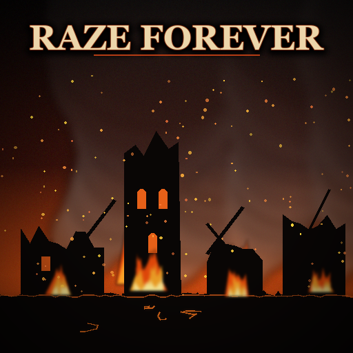

<p align="center">
  
</p>

<h1 align="center">Raze Forever / Стереть навсегда</h1>

<p align="center"><i>"Some places should never rise again."</i></p>

<p align="center">
  <a href="https://steamcommunity.com/sharedfiles/filedetails/?id=3820765666">Steam Workshop</a> ·
  <a href="https://www.nexusmods.com/totalwarwarhammer3/mods/413">Nexus Mods</a> ·
  <a href="LICENSE">MIT License</a>
</p>

**Archaon is not the only one who can end the world.** This Total War: WARHAMMER III mod gives every culture a **Raze Forever** option next to the usual Raze. The settlement is wiped off the map, and its ruins can never be occupied or colonised again, by anyone, you included. It is the same permanent block Archaon uses on his Lord of the End Times path, now available to every faction.

| | |
|---|---|
| **Download** | [Steam Workshop](https://steamcommunity.com/sharedfiles/filedetails/?id=3820765666) · [Nexus Mods](https://www.nexusmods.com/totalwarwarhammer3/mods/413) |
| **Game** | Total War: WARHAMMER III, update 9.0 (Lords of the End Times) |
| **Cultures** | all, except Nagash's Undead Legions |
| **Languages** | every game language |
| **Save-game** | safe to add mid-campaign, do not remove mid-campaign |
| **Tests** | 83 automated tests (pack/db encoding, generated options, the campaign script) |

*Русская версия ниже.*

## Features

- **Raze Forever** option after capturing a settlement, for every culture except Nagash's Undead Legions (devastation is already their whole mechanic).
- The ruins get the vanilla "devastated" look and a permanent occupation block — the engine's own `block_region_occupation`, not an "AI won't target it" trick.
- When more than half of a province's settlements are in ruins, the province gets the campaign devastation visuals, but only for cultures that fit:
  - Chaos wasteland: Warriors of Chaos, Khorne, Nurgle, Slaanesh, Tzeentch, Daemons of Chaos, Beastmen, Norsca, Chaos Dwarfs;
  - Skaven blight: Skaven;
  - Nagash's dead land: Vampire Counts, Vampire Coast;
  - everyone else (Empire, Bretonnia, Dwarfs, Kislev, Cathay, elves, Lizardmen, Greenskins, Ogres, Tomb Kings…) leaves the land as it is.
- No corruption, no climate change, no faction bonuses. The option costs and loots exactly like that culture's normal raze, minus faction-specific raze rewards (skulls, chivalry, souls…) — those stay with the vanilla Raze.
- Human players only: the AI never gets a permanent block from it.
- Works with Archaon's Destroyer path: his own script still devastates the province and counts it toward his bonuses and long victory.
- Works in every game language: the option reads **"Raze: Scorched Earth"**, using the game's own translations.

## Install

Subscribe on the [Steam Workshop](https://steamcommunity.com/sharedfiles/filedetails/?id=3820765666), or download from [Nexus Mods](https://www.nexusmods.com/totalwarwarhammer3/mods/413) and copy **`permanent_raze.pack`** into the game's `data` folder. Enable it in the launcher.

Safe to add to a running campaign. **Do not remove it mid-campaign**: saves reference the mod's effect bundle and may fail to load, and erased ruins could become settleable again.

## Known behaviour

- On the very first scripted capture of some campaigns (the "Attack the enemy" tutorial mission, e.g. Ku'gath, Skaven, Chaos Dwarfs starts) the game ignores any raze option, vanilla Raze included; the settlement stays with the enemy and the "Capture and occupy" mission follows. Later captures work normally.
- When an endgame crisis ends, the game may clear devastation visuals in its area; the ruins stay blocked.
- The new option uses the same picture as the culture's Raze; only the label and tooltip differ.

## Building from source

Requires Python 3.14 and the game installed (the builder reads vanilla `db.pack`).

```bash
python -m pip install pytest lupa
python -m pytest
python -m tools.build
```

`python -m tools.build` writes `dist/permanent_raze.pack` and its Workshop preview image `dist/permanent_raze.png` (drawn by `tools/preview.py`). `--install` also copies both into the game's `data` folder (close the game first). Game path: `tools/paths.py`.

### How it works

- `tools/generate.py` clones each culture's vanilla "raze without occupy" option (one per option group, faction rewards stripped), Archaon's permanent block effect and bundle, and builds the loc entries from `tools/texts.py`.
- `tools/build.py` writes the db tables, loc and the campaign script into PFH5 packs (`tools/packfile.py`, `tools/dbtable.py`, `tools/loc.py`, RPFM schema in `schemas/`).
- `src/script/campaign/mod/permraze.lua` listens for the occupation decision and the raze, then blocks the region, sets the devastated look and, past the province threshold, activates the devastation area. Tested through `lupa` against a mock of the campaign API (`tests/lua/mock_game.lua`).

### Texts

The mod writes no translations of its own: [`tools/texts.py`](tools/texts.py) composes every text from strings the game already ships in all its languages, referenced as `{{tr:key}}` (for example "Raze" + "Scorched Earth"). A test checks that each referenced string exists in every game language.

## Credits

- [RPFM](https://github.com/Frodo45127/rpfm) and its [schemas](https://github.com/Frodo45127/rpfm-schemas) by Frodo45127 — the table layouts in `schemas/` come from there.
- Creative Assembly, for Archaon's devastation mechanic this mod borrows.

## License

The mod's code, scripts and texts are released under the [MIT License](LICENSE) © 2026 Skylar92. Total War: WARHAMMER III and its game data, art and mechanics belong to Creative Assembly and Games Workshop; this is an unofficial fan mod and is not endorsed by them.

---
