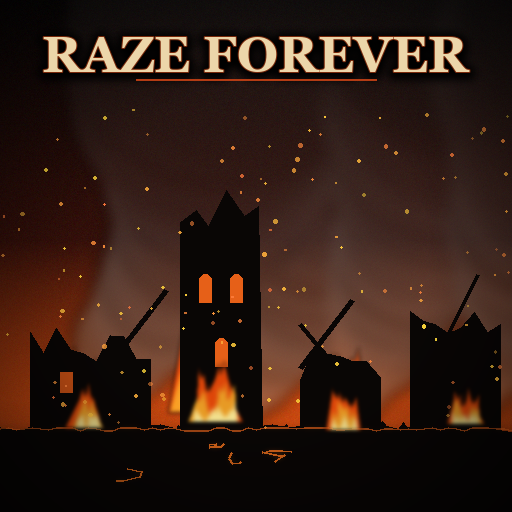

<p align="center">
  
</p>

<h1 align="center">Raze Forever / Стереть навсегда</h1>

<p align="center"><i>"Some places should never rise again."</i></p>

<p align="center">
  <a href="https://steamcommunity.com/sharedfiles/filedetails/?id=3820765666">Steam Workshop</a> ·
  <a href="https://www.nexusmods.com/totalwarwarhammer3/mods/413">Nexus Mods</a> ·
  <a href="LICENSE">MIT License</a>
</p>

**Archaon is not the only one who can end the world.** This Total War: WARHAMMER III mod gives every culture a **Raze Forever** option next to the usual Raze. The settlement is wiped off the map, and its ruins can never be occupied or colonised again, by anyone, you included (unless you turn on rebuilding in MCT). It is the same permanent block Archaon uses on his Lord of the End Times path, now available to every faction.

| | |
|---|---|
| **Download** | [Steam Workshop](https://steamcommunity.com/sharedfiles/filedetails/?id=3820765666) · [Nexus Mods](https://www.nexusmods.com/totalwarwarhammer3/mods/413) |
| **Game** | Total War: WARHAMMER III, update 9.0 (Lords of the End Times) |
| **Cultures** | all, except Nagash's Undead Legions |
| **Languages** | every game language |
| **Save-game** | safe to add mid-campaign, do not remove mid-campaign |
| **Tests** | 299 automated tests (pack/db encoding, generated options, the campaign script) |

## Features

- **Raze Forever** option after capturing a settlement, for every culture except Nagash's Undead Legions (devastation is already their whole mechanic).
- The ruins get the vanilla "devastated" look, a burning "Scorched Earth" icon next to their name and a permanent occupation block — the engine's own `block_region_occupation`, not an "AI won't target it" trick.
- When more than half of a province's settlements are in ruins, the province gets the campaign devastation visuals, but only for cultures that fit:
  - Chaos wasteland: Warriors of Chaos, Khorne, Nurgle, Slaanesh, Tzeentch, Daemons of Chaos, Beastmen, Norsca, Chaos Dwarfs;
  - Skaven blight: Skaven;
  - Nagash's dead land: Vampire Counts, Vampire Coast;
  - everyone else (Empire, Bretonnia, Dwarfs, Kislev, Cathay, elves, Lizardmen, Greenskins, Ogres, Tomb Kings…) leaves the land as it is.
- By default no corruption, no climate change, no faction bonuses. With the optional [Mod Configuration Tool](https://steamcommunity.com/sharedfiles/filedetails/?id=2927955021) erased ruins can spread the destroyer's corruption or cleanse it (see below). The option costs, loots and rewards exactly like that culture's normal raze: skulls, chivalry, souls, Waaagh, forest health and the rest come along.
- Human players only by default: the AI never picks the option. An optional MCT setting lets AI razes erase ruins too (see below).
- Works with Archaon's Destroyer path: his own script still devastates the province and counts it toward his bonuses and long victory.
- Works in every game language: the option reads **"Raze: Scorched Earth"**, using the game's own translations.

## Optional: rebuilding erased ruins (MCT)

Off by default. With the [Mod Configuration Tool](https://steamcommunity.com/sharedfiles/filedetails/?id=2927955021), tick **Players can rebuild erased ruins** on the **General** page of **Raze Forever** to undo a mistake or bring back a settlement you need later.

- Move an army into the ruins' region or a region next to it. On your turn the block is lifted from those ruins only, and the vanilla **Colonise** works at the usual cost: you get a tier 1 settlement.
- The block comes back as soon as the army leaves, and always before the AI moves. The AI can never rebuild erased ruins.
- Ruins stay shut for the rest of the turn they were erased in.
- A rebuilt settlement loses the devastated look and its corruption. The scorched land goes once no more than half of the province is in ruins. It can be erased again.
- The big burning icon on the settlement label is drawn by the game only while you cannot occupy the ruins, so it goes out where an army can rebuild; the small Scorched Earth icon next to the name stays.

## Optional: the AI erases ruins too (MCT)

Off by default. Tick **The AI erases ruins forever too** on the **AI erasing** page and every settlement the AI razes may be erased forever. The chances below it stay locked until the box is ticked:

- **General AI chance:** 25% by default (1–100%), used by every culture left at **General**.
- **By culture:** one dropdown per culture: **General** (default) or 0–100% in steps of 5. General uses the general chance, 0% means that culture never erases, any other value is its own chance. For example, set Chaos to 40%, Beastmen to 60% and everyone else to 0 for a lore-friendly map where only the destroyers burn the land for good.

- The AI cannot choose Raze Forever on purpose, so the chance is rolled on each of its razes. Erased ruins are blocked, marked and scorched exactly as yours are, and count toward corruption by the culture of the faction that erased them.
- Your own Raze Forever works as before; the chance never applies to human players.
- With rebuilding on, you can rebuild ruins the AI erased too, so a settlement a mission needs is not lost for good.
- Nagash's Undead Legions are left out, as they have no Raze Forever button.
- Fair warning: with a high chance, Chaos, Beastmen and friends can turn half the map into ruins nobody can settle. The result may be insane.

## Optional: the Chaos Invasion erases its ruins (MCT)

Off by default. Tick **Chaos Invasion erases ruins forever** in the **End Times** section of the **AI erasing** page, and every settlement Archaon's End Times invasion razes is erased forever, so it stays in ruins after the End Times are over.

- Every raze by the invasion's armies is erased, with no roll. It works on its own: AI erasing does not need to be on.
- The settlements the invasion razes the moment it begins (the old Chaos lands and its landing points) are erased too.
- While the invasion runs, its own script keeps scorching the land: the small devastation icon on every razed settlement and the wasteland once more than half of a province is razed, erased ruins included.
- When the End Times end, the game makes its ruins settleable again; erased ones stay blocked. With **Players can rebuild erased ruins** on, only you can resettle them.
- Other factions' razes during the invasion are not affected; they follow the AI erasing settings as usual.

## Optional: corruption settings (MCT)

Without the [Mod Configuration Tool](https://steamcommunity.com/sharedfiles/filedetails/?id=2927955021) nothing changes: no corruption, exactly as before. With it, the **Corruption** page lets erased ruins spread the destroyer's corruption or cleanse it.

- **Mode:** Off (default) / per settlement / per province. Settings the chosen mode does not use are locked: everything while Off, the province strength and threshold per settlement, the ruin strength per province.
- **Strength:** ruin 5 (default), province 30 (the same as Archaon's devastated province), multiplier 100% (0–300%).
- **Province threshold:** more than 50% of the province's settlements by default; only ruins erased with Raze Forever count.
- **By culture:** each culture has a dropdown: nothing / cleanse (Untainted) / spread a corruption type. Defaults: Chaos factions, Daemons, Norsca, Beastmen and Chaos Dwarfs spread Chaos Undivided; Khorne, Nurgle, Slaanesh and Tzeentch spread their own god's corruption; Skaven spread Skaven corruption; Vampire Counts and Vampire Coast spread Vampiric corruption; Empire, Bretonnia, Dwarfs, Kislev, Cathay, High Elves, Wood Elves and Lizardmen cleanse; Dark Elves, Greenskins, Ogres and Tomb Kings do nothing.
- **Fixed exceptions:** Morathi spreads Slaanesh, the Glottkin (Host of the Triplets) spread Nurgle. An option (off by default) makes a Daemon Prince follow the god they ascended to.
- Settings are per campaign and can be changed mid-campaign; all ruins are recalculated when you do. Only ruins erased by human players count, plus the AI's when the AI erases ruins too. Province mode does not stack on provinces the game itself has already devastated (Archaon, endgames).

## Install

Subscribe on the [Steam Workshop](https://steamcommunity.com/sharedfiles/filedetails/?id=3820765666), or download from [Nexus Mods](https://www.nexusmods.com/totalwarwarhammer3/mods/413) and copy **`permanent_raze.pack`** into the game's `data` folder. Enable it in the launcher.

Safe to add to a running campaign. **Do not remove it mid-campaign**: saves reference the mod's effect bundle and may fail to load, and erased ruins could become settleable again.

## Known behaviour

- On the very first scripted capture of some campaigns (the "Attack the enemy" tutorial mission, e.g. Ku'gath, Skaven, Chaos Dwarfs starts) the game ignores any raze option, vanilla Raze included; the settlement stays with the enemy and the "Capture and occupy" mission follows. Later captures work normally.
- When an endgame crisis ends, the game may clear devastation visuals in its area; the ruins stay blocked.
- The new option uses the same picture as the culture's Raze; only the label and tooltip differ.

## Building from source

Requires Python 3.14 and the game installed (the builder reads vanilla `db.pack`).

```bash
python -m pip install pytest lupa
python -m pytest
python -m tools.build
```

`python -m tools.build` writes `dist/permanent_raze.pack` and its Workshop preview image `dist/permanent_raze.png` (drawn by `tools/preview.py`). `--install` also copies both into the game's `data` folder (close the game first). `--log` makes a debug build that also writes its log to `permraze_log.txt` in the game folder. Game path: `tools/paths.py`.

### How it works

- `tools/generate.py` clones each culture's vanilla "raze without occupy" option (one per option group, rewards and costs kept), Archaon's permanent block effect and bundle, and builds the loc entries from `tools/texts.py`.
- `tools/build.py` writes the db tables, loc and the campaign script into PFH5 packs (`tools/packfile.py`, `tools/dbtable.py`, `tools/loc.py`, RPFM schema in `schemas/`).
- `tools/corruption.py` holds the corruption data (culture defaults, effect keys, MCT texts); `src/script/mct/settings/permraze.lua` is the optional MCT settings file (three pages, with options locked while the AI switch or the corruption mode makes them pointless); `src/script/campaign/mod/permraze_corruption.lua` reads those settings and applies the corruption of erased ruins.
- `src/script/campaign/mod/permraze.lua` listens for the occupation decision and the raze, then blocks the region, sets the devastated look and, past the province threshold, activates the devastation area. With rebuilding on, it lifts the block next to human armies during human turns and undoes the erasure when the ruins are colonised. With AI erasing on, it rolls the MCT chance (the razing culture's own, else the general one) on every AI raze and rebuilds the corruption of those ruins once per round. Tested through `lupa` against a mock of the campaign API (`tests/lua/mock_game.lua`).

### Texts

The mod writes no translations of its own: [`tools/texts.py`](tools/texts.py) composes every text from strings the game already ships in all its languages, referenced as `{{tr:key}}` (for example "Raze" + "Scorched Earth"). A test checks that each referenced string exists in every game language.

## Credits

- [RPFM](https://github.com/Frodo45127/rpfm) and its [schemas](https://github.com/Frodo45127/rpfm-schemas) by Frodo45127 — the table layouts in `schemas/` come from there.
- Creative Assembly, for Archaon's devastation mechanic this mod borrows.

## License

The mod's code, scripts and texts are released under the [MIT License](LICENSE) © 2026 Skylar92. Total War: WARHAMMER III and its game data, art and mechanics belong to Creative Assembly and Games Workshop; this is an unofficial fan mod and is not endorsed by them.

---
